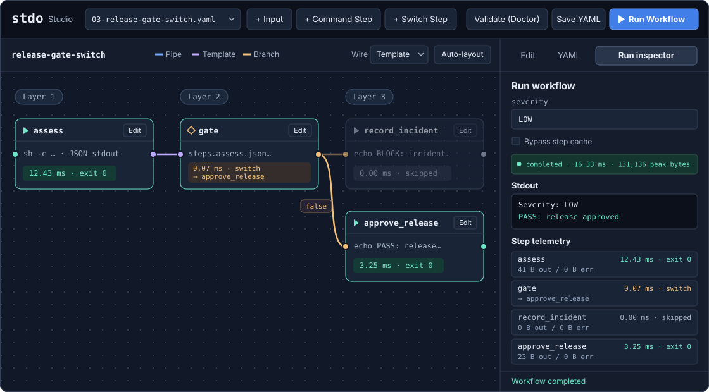

<div align="center">

# ⚡ `stdo`

**Standard I/O Orchestrator — Workflow-as-Code meets the Unix Philosophy.**

A compact, zero-network Rust binary that orchestrates local CLI tools (`curl`, `ollama`, `rg`, `jq`, `sqlite3`, `dscr`) over `stdin` and `stdout` pipes.

[](https://crates.io/crates/stdo)
[](https://github.com/adiktiv-technologies/stdo/blob/main/LICENSE)
[](#architecture--core-concepts)
[](https://github.com/adiktiv-technologies/stdo/blob/main/Cargo.toml)

[**Quickstart**](#quickstart) • [**What is a Unix DAG?**](#what-is-a-unix-dag) • [**Embedded Studio (`stdo serve`)**](#embedded-studio-stdo-serve) • [**Roadmap**](#roadmap)

</div>

> [!NOTE]
> **Phases 1 and 2 are complete in `v0.2.0`.** The release includes `stdo doctor`, `stdo run`, `--telemetry`, SHA-256 content-addressable caching in `.stdo/cache/`, and the zero-CDN WYSIWYG Studio in `stdo serve`. Phase 3 (`v0.3.0`) is next, with `stdo bench`, live SSE streaming, and offline audit exports.

## Why `stdo`?

Modern AI, data, and automation orchestrators (like Dify, Airflow, or Langflow) suffer from severe infrastructure bloat: they demand multi-container Docker stacks, PostgreSQL, Redis, and lock your logic into fragile Python SDKs that break every month.

**`stdo` (pronounced _"studio"_ or _"S-T-D-O"_) takes the radical Unix path:**

1. **Zero HTTP Client Inside:** `stdo` contains no outbound network stack (`no reqwest`, `no openssl`). Need a REST API? Call `curl`. Need a local LLM? Call `ollama` or `llama-cli`. Need vector or relational queries? Call `sqlite3`.
2. **True `stdin` / `stdout` Piping (No `ARG_MAX` Crashes):** Passing megabytes of JSON or RAG context through environment variables (`${OUTPUT}`) crashes the OS kernel (`ARG_MAX` limit) and invites shell-injection bugs. `stdo` streams data directly through process file descriptors (`fd 0` and `fd 1`).
3. **Content-Addressable Cache:** Deterministic steps can reuse captured output from a previous run.
4. **Embedded Offline Studio:** Edit the execution graph, configure inputs, and inspect completed runs from a local browser.

## What is a Unix DAG?

At the heart of `stdo` is a **DAG (_Directed Acyclic Graph_)**:

- **Directed:** Data flows in a clear, deterministic direction from upstream producer processes to downstream consumer processes.
- **Acyclic:** The graph contains no infinite loops that could lock up unattended pipelines or CI/CD runners; every execution path is guaranteed to terminate.
- **Graph:** Unlike a linear Bash pipe (`cmd1 | cmd2 | cmd3`), a DAG supports **parallel fan-out** (running 4 CLI tools simultaneously), **fan-in aggregation** (combining outputs from multiple tools into a single LLM prompt), and **conditional branching** (`switch` routing based on structured JSON output or exit codes).

```text
                  ┌──► [ Step B: rg (Static Scan) ] ──────┐
[ Inputs / CLI ] ─┤                                       ├──► [ Step D: ollama / dscr ] ──► [ Switch ]
                  └──► [ Step C: sqlite3 (Fetch Rules) ] ─┘                                    ├─► PASS
                                                                                               └─► BLOCK
```

Before starting subprocesses, `stdo run` sorts and validates the DAG. Use `stdo doctor` to check the graph and confirm executable availability without starting any workflow commands.

## Quickstart

### 1. Install

```sh
cargo install stdo --locked
```

Download a prebuilt binary for your platform from [GitHub Releases](https://github.com/adiktiv-technologies/stdo/releases). Linux builds use static musl binaries.

To build from source:

```sh
git clone https://github.com/adiktiv-technologies/stdo.git
cd stdo
cargo install --path . --locked
```

### 2. Define your workflow (`stdo.yaml`)

`stdo` supports two complementary data-passing modes between nodes:

- **Buffered Templating (`stdin: "{{ steps.x.stdout }}"`):** Waits for step `x` to complete, then injects its output into a template (ideal for assembling multi-source prompts).
- **Monitored Pipe (`pipe_from: step_x`):** Captures `step_x`'s stdout in 64 KiB reads and writes those bytes to the downstream command's stdin after the upstream layer finishes. Both stdout and stderr are drained while stdin is being written.

By default, `run` and `doctor` allow up to 64 steps, 16 layers, and 16 steps per layer. Use `--force` to bypass these graph limits. Subprocess streams still have an 8 MiB limit each, with a shared 32 MiB budget for captured data, pipe read buffers, and rendered I/O buffers. On failure, `stdo run` prints the PID and last known status of each direct child it started.

Use `{{ inputs.key }}` in command arguments and pass step output through `stdin` templates or `pipe_from`. The workflow's `output` template determines what `stdo run` writes to stdout.

Pass `--telemetry` (`-t`) to print step and layer timings, time to first byte (TTFB), captured byte counts, and peak monitored buffer usage to stderr. Failed runs include a partial report. Failed commands also surface captured stderr above the PID ledger.

Set `cache: true` on a deterministic command step to reuse its output from `.stdo/cache/` under the working directory. The SHA-256 key covers rendered arguments, stdin bytes, and the step's exit-code and output-parsing settings. If the command depends on files, environment variables, or other external state, account for those inputs in the workflow or run with `--no-cache` to bypass cache reads and writes. Telemetry reports cache hits separately from executed commands.

```yaml
version: "1.0"
name: "offline-code-triage"
description: "100% local security audit orchestrating ripgrep, SQLite, and Ollama"

inputs:
  target_dir:
    type: path
    default: "./src"
    description: "Directory to scan"
  severity:
    type: enum
    values: ["LOW", "HIGH", "CRITICAL"]
    default: "HIGH"

steps:
  # Runs in parallel with fetch_policy (no dependencies between them)
  - id: scan_code
    name: "Static secret & unsafe pattern scan"
    cmd:
      [
        "rg",
        "--json",
        "-e",
        "password|secret|api_key|unsafe",
        "{{ inputs.target_dir }}",
      ]
    ignore_exit_code: true

  # Runs in parallel with scan_code
  - id: fetch_policy
    name: "Load internal security rules from SQLite"
    cmd: ["sqlite3", "-json", "./security_rules.db"]
    stdin: |
      SELECT rule_id, description FROM rules WHERE severity = '{{ inputs.severity }}';

  # Fan-in: waits for both scan_code and fetch_policy
  - id: local_llm_audit
    name: "Triage findings with local LLM"
    cmd: ["ollama", "run", "qwen2.5-coder:7b", "--format", "json"]
    cache: true
    stdin: |
      You are an offline security auditor.
      Rules: {{ steps.fetch_policy.stdout }}
      Findings: {{ steps.scan_code.stdout }}
      Respond ONLY with JSON: {"block_release": boolean, "summary": string}
    parse_stdout: json

  # Deterministic conditional routing
  - id: release_gate
    type: switch
    condition: "{{ steps.local_llm_audit.json.block_release }}"
    cases:
      "true": record_incident
      "false": approve_release

  - id: record_incident
    cmd: ["sqlite3", "./security_rules.db"]
    stdin: |
      INSERT INTO incidents (summary, ts)
      VALUES ('{{ steps.local_llm_audit.json.summary }}', datetime('now'));

  - id: approve_release
    cmd: ["echo", "Release approved."]

output: "{{ steps.local_llm_audit.json.summary }}"
```

### 3. Execute or Inspect Visually

```bash
# Validate a bundled workflow and check its required executables
stdo doctor -f examples/01-parallel-repo-audit.yaml

# Run it headlessly from the repository root
stdo run -f examples/01-parallel-repo-audit.yaml

# Keep the workflow output on stdout and write telemetry to stderr
stdo run -t -f examples/01-parallel-repo-audit.yaml
```

See the [workflow gallery](examples/README.md) for the ETL and release gate examples.

### Benchmark workflows and export audit reports

```sh
stdo run -f examples/03-release-gate-switch.yaml -i severity=LOW --report audit.json
stdo bench examples/01-parallel-repo-audit.yaml examples/02-monitored-pipe-etl.yaml \
  --runs 5 --warmup 1 --no-cache --report comparison.html
```

`run --report` keeps workflow stdout available for piping and writes the audit to a separate file, including partial results when a readable workflow fails. It records the resolved inputs, SHA-256 hashes of the original YAML and captured stdout, and per-step timings and byte counts. Reports contain resolved input values, so treat them as sensitive if the workflow takes secrets. Use `.html` or `.htm` for a self-contained report, or another extension for JSON.

`bench` accepts one or more workflows and compares them against the first workflow's median latency. It runs one warmup and five measured trials per workflow by default. The table reports min, mean, p50, p95, max, mean TTFB, peak monitored bytes, and cache hit ratio, plus per-step mean and p95. Percentiles use linear interpolation, and the cache ratio is the number of hits divided by all recorded steps. Pass `-i KEY=VALUE` for an override shared by the workflows. Cached steps can reuse results during warmup and measurement. Pass `--no-cache` to measure subprocess execution on every trial. HTML benchmark reports include four inline charts.

Step TTFB measures from spawn to the first stdout chunk, or the read duration on a cache hit. Workflow TTFB is elapsed time to the first stdout from any step, with total duration as the fallback for a silent run. Benchmarks load each workflow once before its trials.

## Embedded Studio (`stdo serve`)

Studio is an offline workflow editor for wiring DAG steps, editing YAML, and inspecting runs in your browser.



```sh
stdo serve -f examples/03-release-gate-switch.yaml --port 8080
```

Open [Studio](http://127.0.0.1:8080) in your browser. With no file argument, Studio selects `stdo.yaml` if present, then the first YAML file from the working directory or `examples/`. Studio binds to IPv4 loopback and serves the editor from the binary.

- Drag nodes to arrange them. Connect output and input ports to add pipe, template, or switch links. Click an edge to remove it.
- Use **Edit** to configure workflow inputs and steps, or use **YAML** to edit the same draft as text. **Validate (Doctor)** checks the draft. **Save YAML** validates the DAG and atomically writes it inside the working directory.
- Use **Run Workflow** to execute the draft with optional input overrides and cache bypass. The inspector shows workflow stdout, captured stderr excerpts, timings, cache hits, and the PID ledger on failure.

## Roadmap

### Phase 1 — Foundation (`v0.0.x` → `v0.1.0`)

- [x] Crate reservation & baseline CLI (`stdo`).
- [x] Topological DAG parser (`stdo.yaml`), cycle detector, and `stdo doctor` binary verifier.
- [x] Buffered `minijinja` stdin templates and monitored `pipe_from` transfers.
- [x] Parallel execution within each topological layer via `tokio::process`.
- [x] Self-contained POSIX workflow gallery in `examples/` (fan-out, `pipe_from`, JSON switch routing).

### Phase 2 — Caching & Embedded Studio (`v0.2.0`)

- [x] SHA-256 Content-Addressable Storage (CAS) for command steps in `.stdo/cache/`.
- [x] `stdo serve` loopback HTTP server with a single embedded HTML/CSS/JS editor and SVG canvas.
- [x] Workflow file editing, validation, execution, and per-step telemetry in Studio.

### Phase 3 — Industrial Benchmarking & Streaming (`v0.3.0`)

- [ ] Live Studio output streaming over server-sent events (SSE) and workflow file reload.
- [x] `stdo bench` A/B/C comparisons with latency percentiles, TTFB, cache hit ratios, and peak monitored buffer usage.
- [ ] Continuous JSONL line-by-line stream routing for high-frequency sensor and log pipelines.
- [x] Offline HTML/JSON execution audits and benchmark reports.

## License

Licensed under the **Apache License, Version 2.0** ([LICENSE](https://github.com/adiktiv-technologies/stdo/blob/main/LICENSE) or http://www.apache.org/licenses/LICENSE-2.0).
